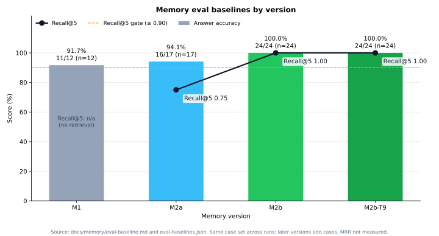
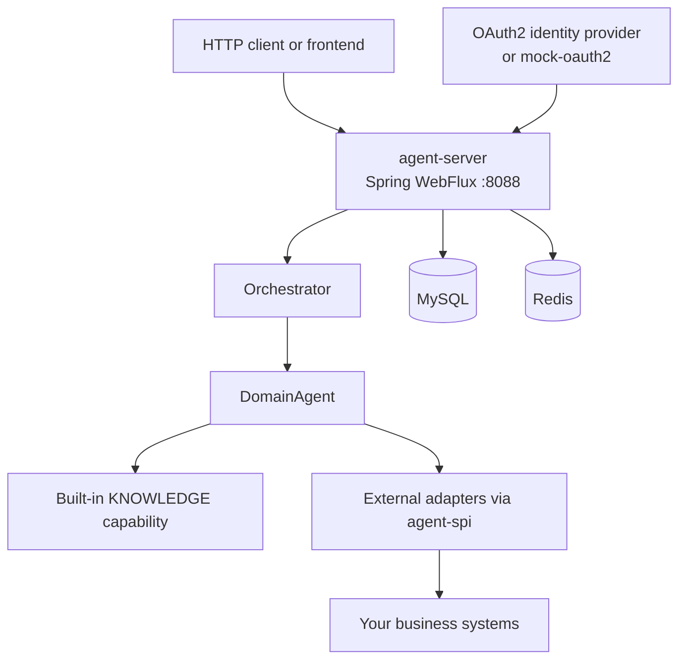

# Agile Agent

Enterprise Agent server for Java and Spring: multi-tenant OAuth2, long-term memory, and a pluggable capability SPI.

[](https://openjdk.org/projects/jdk/25/)
[](https://spring.io/projects/spring-boot)
[](https://docs.spring.io/spring-framework/reference/web/webflux.html)
[](LICENSE)
[中文文档](README.zh-CN.md)



*Memory eval by version — bars: answer accuracy (correct/total, with case count n); line: Recall@5 from M2a onward (M1 is n/a — full history, no retrieval). Numbers from the live-model baselines in [docs/memory/eval-baseline.md](docs/memory/eval-baseline.md) / [eval-baselines.json](docs/memory/eval-baselines.json). MRR was not measured.*

Most Agent toolkits are libraries you embed in your own process. Agile Agent is a **deployable Agent server** for teams that already run Java and Spring: HTTP APIs, OAuth2 login, per-tenant model configuration, conversation memory, and business capabilities that plug in as ordinary Maven dependencies.

## Why Agile Agent

The Java/Spring enterprise stack has plenty of LLM *libraries*. It has fewer ready-to-run Agent *servers* that already speak multi-tenant identity, encrypted tenant model keys, and durable memory.

- **A server, not a SDK.** `agent-server` exposes HTTP APIs, authentication, orchestration, model integration, and a built-in `KNOWLEDGE` capability. You deploy it; you do not have to assemble an Agent runtime from scratch.
- **Stable capability SPI.** External systems connect through `agent-spi` (`AgentCapabilityProvider` and related types). Adapters are regular Spring Boot dependencies—the server does not download or dynamically load JARs.
- **Orchestrator + domain agents.** An `Orchestrator` routes each turn to a `DomainAgent`, which only executes tools declared by the selected capability.
- **Multi-tenant OAuth2.** Authorization-code login against your identity provider, with claim mappings for tenant, roles, and organization scope. A standalone `mock-oauth2` module exists for local development only.
- **Memory built for production conversations.** Three phases on `main`: durable persistence and crash recovery (M1), context budget plus Chinese full-text recall (M2a), and long-term memory with provenance, anti-poisoning checks, and opt-in compression (M2b).
- **Reactive throughout.** JDK 25 and Spring Boot 3.5.16 with `spring-boot-starter-webflux`. SPI methods return Reactor `Mono` values.

## Architecture



Maven modules:

| Module | Role |
| --- | --- |
| `agent-spi` | Public identity and capability contracts used by server-side adapters |
| `agent-server` | HTTP APIs, authentication, orchestration, model integration, memory, and `KNOWLEDGE` |
| `mock-oauth2` | Standalone development identity service for local OAuth2 login |

## Key features

- **Capability adapters.** Implement `AgentCapabilityProvider` (`code()`, `displayName()`, `routingDescription()`, `definition(...)`, `execute(...)`) and register a Spring bean. See [Write your own capability adapter](#write-your-own-capability-adapter).
- **Built-in `KNOWLEDGE` capability.** The server ships a knowledge-base provider that lets the model read approved documents through `readKnowledgeDoc`.
- **OAuth2 multi-tenancy.** Configure authorization, token, user-info, and optional revocation endpoints; map subject, tenant, roles, and readable/manageable organization IDs from user-info claims.
- **Tenant LLM configuration.** Tenant model API keys are encrypted with `LLM_CONFIG_SECRET`. The same secret must be used by every instance that reads those keys.
- **Conversation memory (M1 / M2a / M2b).** MySQL-backed conversations, turns, tool calls, and attachments; interrupted-turn recovery and single-instance protection; per-model context budget and Chinese full-text recall (no vector service); LLM + versioned Rules memory judgement with provenance and anti-poisoning checks.
- **Opt-in storage features.** Memory judgement, turn records, and raw-message compression default to off. Cross-conversation recall is off by default.

Current operational constraint: **one live server instance per deployment namespace**. See [Documentation](#documentation).

## How it compares

LangChain4j and Spring AI are excellent libraries for calling models and composing Agent logic *inside* an application you write. Agile Agent is a different layer: a multi-tenant Agent **service** you deploy, then extend with capability adapters.

| | LangChain4j | Spring AI | Agile Agent |
| --- | --- | --- | --- |
| What you take home | A Java library you embed | A Spring library you embed | A deployable Agent server (`agent-server`) plus `agent-spi` |
| Identity | You wire it in your app | You wire it in your app | Built-in OAuth2 authorization-code login and tenant/org claim mapping |
| Extending tools / skills | Library APIs in your process | Library APIs in your process | `AgentCapabilityProvider` adapters as Maven dependencies |
| Conversation memory | You choose and integrate a store | You choose and integrate a store | Built-in M1 / M2a / M2b memory, APIs, and eval baselines |
| Typical use | Build Agent features into an existing service | Build Agent features into a Spring app | Run an Agent platform and plug business systems into it |

This table is about positioning, not a feature checklist of the other projects.

## Quick start

The shortest local path is the Compose `local-mock` profile. It starts an isolated server, the mock identity provider, MySQL, and Redis.

**Prerequisites:** JDK 25, Maven, Docker Compose, and a way to generate `LLM_CONFIG_SECRET` (the example uses `openssl`). The stack runs on MySQL 8.4 and Redis; the server image is based on `eclipse-temurin:25-jdk-alpine-3.22` with a fixed 1 GB heap (`-Xms1024m`/`-Xmx1024m`). Reserve additional memory beyond the heap for the container.

```sh
export LLM_CONFIG_SECRET="$(openssl rand -base64 32)"
mvn -pl agent-server,mock-oauth2 -am -DskipTests package
docker compose -f docker/docker-compose.yml --profile local-mock up --build agile-agent-server-local-mock
```

Then open `http://localhost:8088/api/auth/oauth2/authorize`. The server redirects to the mock identity chooser on port 8090; after you pick a seeded identity, the callback redirects to `http://localhost:5173/login/callback#token=...`. The fragment contains the Agile Agent application token. A frontend on port 5173 is only needed to *render* that final route—the token is already in the URL.

Notes:

- Keep `LLM_CONFIG_SECRET` stable while encrypted tenant keys need to be read, including across restarts, redeployments, and restores of the same database; never commit it. Compose has no fallback value.
- The server's other production OAuth settings include `OAUTH2_AUTHORIZATION_URI`, `OAUTH2_TOKEN_URI`, `OAUTH2_USERINFO_URI`, optional `OAUTH2_REVOCATION_URI`, `OAUTH2_CLIENT_ID`, and `OAUTH2_CLIENT_SECRET`. Configure the claim mappings such as `OAUTH2_CLAIM_SUBJECT`, `OAUTH2_CLAIM_DISPLAY_NAME`, `OAUTH2_CLAIM_ROLES`, `OAUTH2_CLAIM_MANAGEABLE_ORG_IDS`, and `OAUTH2_CLAIM_READABLE_ORG_IDS` for your provider's user-info response. See the [OAuth2 provider guide](docs/oauth2-provider-integration.md) for the complete variable list, HTTPS requirements, claim defaults and admin grants for providers without role or organization claims, and a GitHub OAuth App example.
- The local-mock profile publishes the server and mock provider ports on `127.0.0.1` only. They are reachable from the same host and cannot be reached directly from other machines. The published ports are the server (`8088`) and mock provider (`8090`).
- Package `agent-server` and `mock-oauth2` first so Compose can mount the mock provider JAR.
- More local commands (`start.sh`, extra Maven targets, and the image JVM flags) are in [local development](docs/local-development.md).
- This profile is for isolated development. Do not expose the mock provider to the internet or reuse its development passwords elsewhere.

Seeded mock identities (local fixtures, not business accounts): `platform-admin`, `tenant-a-admin`, `tenant-a-user`, `tenant-b-admin`, and `tenant-b-user`. Details are in the [OAuth2 provider guide](docs/oauth2-provider-integration.md#local-mock-provider).

To stop the stack, press Ctrl-C. Remove local development databases and uploaded files with:

```sh
docker compose -f docker/docker-compose.yml --profile local-mock down -v
```

> A web frontend is planned and will live in the `web/` directory; `start.sh` already starts it when `web/node_modules` is present.


## Write your own capability adapter

Depend on `agile-agent-spi` (not `agent-server` internals) and implement `AgentCapabilityProvider`:

```java
package example.adapter;

import java.util.List;
import java.util.Map;

import com.fasterxml.jackson.databind.ObjectMapper;
import io.github.sukimiya.agileagent.spi.capability.AgentCapabilityProvider;
import io.github.sukimiya.agileagent.spi.capability.AgentExecutionContext;
import io.github.sukimiya.agileagent.spi.capability.CapabilityDefinition;
import io.github.sukimiya.agileagent.spi.capability.ToolDefinition;
import io.github.sukimiya.agileagent.spi.capability.ToolInvocation;
import io.github.sukimiya.agileagent.spi.capability.ToolResult;
import reactor.core.publisher.Mono;

public final class InventoryCapabilityProvider implements AgentCapabilityProvider {
    private static final ObjectMapper JSON = new ObjectMapper();

    @Override
    public String code() {
        return "INVENTORY";
    }

    @Override
    public String displayName() {
        return "Inventory";
    }

    @Override
    public String routingDescription() {
        return "Look up stock levels for catalog items";
    }

    @Override
    public Mono<CapabilityDefinition> definition(AgentExecutionContext context) {
        var schema = JSON.valueToTree(Map.of(
                "type", "object",
                "properties", Map.of(
                        "sku", Map.of("type", "string", "description", "Item SKU")),
                "required", List.of("sku")));
        return Mono.just(new CapabilityDefinition(
                "You help users look up inventory.",
                List.of(new ToolDefinition("lookupStock", "Look up stock for an item SKU", schema))));
    }

    @Override
    public Mono<ToolResult> execute(ToolInvocation invocation, AgentExecutionContext context) {
        // Use context.identity() for authorization. Call context.accessTokenAccessor()
        // only immediately before an authenticated upstream request, and never log the token.
        return Mono.just(new ToolResult(true, "12 units in stock"));
    }
}
```

Register the provider as a Spring bean (typically via `@AutoConfiguration` and `META-INF/spring/org.springframework.boot.autoconfigure.AutoConfiguration.imports`). Capability codes must be stable and unique. Full guidance: [capability adapter guide](docs/capability-adapters.md).

The current reactor version is `0.0.1-SNAPSHOT`; consumers should use a released version when one is published.

## Memory and evaluation

Conversation memory ships in three phases, all on `main`:

- **M1 — durable persistence.** Conversations, turns, tool calls, and attachments are stored in MySQL, with idempotent chat entry points, recovery of interrupted turns, and single-instance protection. [M1 acceptance](docs/memory/phase-1-acceptance.md)
- **M2a — context and recall.** A per-model context budget, background for domain agents, per-turn memory records, and basic recall (deterministic codes plus Chinese full-text; no vector service). Cross-conversation recall is off by default. [M2a acceptance](docs/memory/phase-2a-acceptance.md)
- **M2b — long-term memory.** LLM + versioned global Rules memory judgement with provenance and anti-poisoning checks; corrections update or supersede existing items; a per-tenant consolidation token quota; optional per-user profile and light one-hop relations; per-turn recall explanation and a user memory API; soft deletion, forgetting/restoring in chat, recall-recency decay, Rules version replay, and tiered compression of raw messages. [M2b acceptance](docs/memory/phase-2b-acceptance.md)

The real-model evaluation (`-Pmemory-eval-live`) runs 24 answer cases against one fixed provider model, by hand, in an isolated environment. Results are compared case by case with every recorded baseline in [eval-baselines.json](docs/memory/eval-baselines.json):

- **M2b: 24/24 correct**, with no regressions against M1 (11/12) or M2a (16/17).
- **Recall@5 = 1.00** and source accuracy = 1.00; 0 poisoned items asserted as user facts.
- The Task 9 run forced warm-then-cold compression of every original before the probes and was also **24/24** with no regressions.

Details, cost, and latency are in [eval-baseline.md](docs/memory/eval-baseline.md) sections 4–5. The quality gate is: no regression against any baseline, no poisoned content, and Recall@5 ≥ 0.9.

## Roadmap

Known follow-ups from the current tree:

- Relations have no production write path yet (`main` as of this writing; a write-path change is in progress on a separate branch).
- The compression ratio has not been measured on production data.
- The Alpine image (`eclipse-temurin:25-jdk-alpine-3.22` with zstd-jni) has been verified with a real Docker build on aarch64 musl, not only in a chroot.
- The `Jenkinsfile` builds the server image locally and does not log in to or push to a registry. JDK 25 has been verified in one Jenkins environment; confirm the same JDK on any other build agents before the first release.
- Adaptation of the enterprise API Agent (`mcp-tool`) follows M2 acceptance.

## Documentation

| Topic | Document |
| --- | --- |
| Capability adapters | [docs/capability-adapters.md](docs/capability-adapters.md) |
| Production OAuth2 | [docs/oauth2-provider-integration.md](docs/oauth2-provider-integration.md) |
| Local development (Maven, `start.sh`, image flags) | [docs/local-development.md](docs/local-development.md) |
| Memory HTTP API | [docs/memory/api.md](docs/memory/api.md) |
| Memory operations, single-instance protection, compression, recovery | [docs/memory/operations.md](docs/memory/operations.md) |
| Evaluation baselines | [docs/memory/eval-baseline.md](docs/memory/eval-baseline.md) |
| Migrating from the earlier single-module layout | [docs/spec/migration-from-single-module.md](docs/spec/migration-from-single-module.md) |

Raw-message compression defaults, zstd warm/cold tiers, and related metrics live under [memory operations](docs/memory/operations.md#原始消息分层压缩m2b-task-9默认关闭). Deployment is single-instance (`replicas=1`); a second live instance in the same namespace logs `INSTANCE_CONFLICT`, marks `/actuator/health` `OUT_OF_SERVICE`, and refuses new turns with 503 until only one remains. See [single-instance protection](docs/memory/operations.md#单实例保护). Do not use that health status as a liveness probe that restarts the container.

## Contributing

Issues and pull requests are welcome. For larger changes, open an issue first so the design can be discussed.

- Write tests first, and make sure both the default suite and the real-MySQL integration suite pass before pushing.
- Changes to `main` go through pull requests; please don't force-push.
- Keep the repository vendor-neutral: don't name specific model providers or models in docs (an open-source boundary test enforces this).

- JDK 25 and Maven are required to build from the repository root.
- Default tests: `mvn -pl agent-server -am test`
- Some tests expect `redis-server` on `PATH`. The mock OAuth2 end-to-end test is `mvn -pl agent-server -am -Dtest=MockOAuth2EndToEndTest test`.
- Real-MySQL memory tests and live-model evaluation are opt-in Maven profiles; they are not part of the default build. See [eval-baseline.md](docs/memory/eval-baseline.md).
- The `Jenkinsfile` packages the server and mock provider, then builds a local Docker image. It does not log in to a registry or push the image.

## License


Licensed under the [Apache License 2.0](LICENSE).
