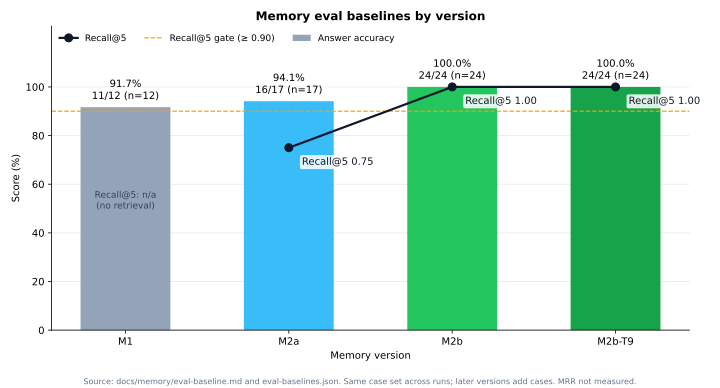
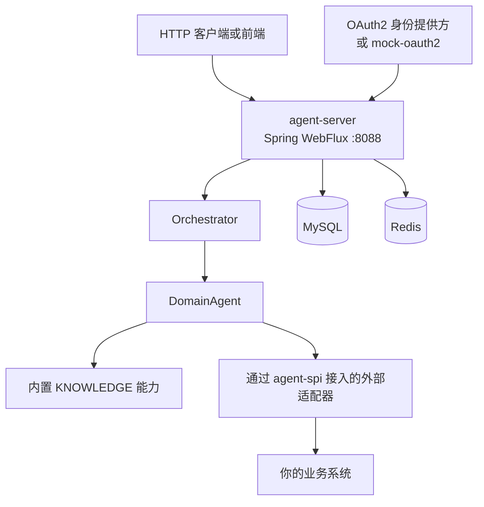

# Agile Agent

面向 Java / Spring 的企业级 Agent 服务端：OAuth2 多租户、长期记忆，以及可插拔的能力 SPI。

[](https://openjdk.org/projects/jdk/25/)
[](https://spring.io/projects/spring-boot)
[](https://docs.spring.io/spring-framework/reference/web/webflux.html)
[](LICENSE)
[English](README.md)



*各版本记忆评测——柱状图：回答正确率（正确数/总数，并标注用例数 n）；折线：从 M2a 起的 Recall@5（M1 为 n/a，全量历史注入、无检索）。数字来自真实模型基线 [docs/memory/eval-baseline.md](docs/memory/eval-baseline.md) / [eval-baselines.json](docs/memory/eval-baselines.json)。未测量 MRR。*

大多数 Agent 工具是嵌进你自己进程里的**库**。Agile Agent 是面向已经在使用 Java 和 Spring 的团队的**可部署 Agent 服务端**：提供 HTTP API、OAuth2 登录、按租户配置模型、对话记忆，以及以普通 Maven 依赖接入的业务能力。

## 为什么选择 Agile Agent

Java / Spring 企业生态里不缺调用大模型的*库*，但少有开箱即用、已经包含多租户身份、租户模型密钥加密和持久化记忆的 Agent *服务端*。

- **是服务端，不是 SDK。** `agent-server` 提供 HTTP API、认证、编排、模型集成和内置 `KNOWLEDGE` 能力。你直接部署它，而不必从零拼一套 Agent 运行时。
- **稳定的能力 SPI。** 外部系统通过 `agent-spi`（`AgentCapabilityProvider` 及相关类型）接入。适配器是普通的 Spring Boot 依赖——服务端不会下载或动态加载 JAR。
- **Orchestrator + 域 Agent。** `Orchestrator` 把每一轮路由到 `DomainAgent`，后者只执行所选能力声明过的工具。
- **OAuth2 多租户。** 使用授权码模式对接你的身份提供方，并映射租户、角色和组织范围。本地开发可用独立的 `mock-oauth2` 模块，请勿用于生产。
- **面向真实对话的记忆。** `main` 上已落地三个阶段：持久化与中断恢复（M1）、上下文预算与中文全文召回（M2a），以及带来源追溯、防投毒校验和可选压缩的长期记忆（M2b）。
- **全链路响应式。** JDK 25、Spring Boot 3.5.16，使用 `spring-boot-starter-webflux`。SPI 方法返回 Reactor `Mono`。

## 架构



Maven 模块：

| 模块 | 职责 |
| --- | --- |
| `agent-spi` | 服务端适配器使用的公开身份与能力契约 |
| `agent-server` | HTTP API、认证、编排、模型集成、记忆，以及 `KNOWLEDGE` |
| `mock-oauth2` | 本地 OAuth2 登录用的独立开发身份服务 |

## 主要能力

- **能力适配器。** 实现 `AgentCapabilityProvider`（`code()`、`displayName()`、`routingDescription()`、`definition(...)`、`execute(...)`）并注册为 Spring Bean。见[编写自己的能力适配器](#编写自己的能力适配器)。
- **内置 `KNOWLEDGE` 能力。** 服务端自带知识库提供者，模型可通过 `readKnowledgeDoc` 读取已审核文档。
- **OAuth2 多租户。** 配置授权、令牌、用户信息和可选的撤销端点；从用户信息声明中映射主体、租户、角色，以及可读/可管理的组织 ID。
- **租户 LLM 配置。** 租户模型 API Key 使用 `LLM_CONFIG_SECRET` 加密。所有需要读取这些密钥的实例必须使用同一份密钥。
- **对话记忆（M1 / M2a / M2b）。** 用 MySQL 保存会话、轮次、工具调用和附件；支持中断恢复和单实例保护；按模型的上下文预算和中文全文召回（不依赖向量服务）；LLM + 版本化 Rules 记忆判断，带来源追溯与防投毒校验。
- **可选存储特性。** 记忆判断、轮次记录和原文压缩默认关闭。跨会话召回默认关闭。

当前运维约束：每个部署命名空间只允许**一个**存活的服务端实例。见[文档](#文档)。

## 和其他项目的定位

LangChain4j 和 Spring AI 是很好的库，适合在你自己编写的应用*内部*调用模型、组合 Agent 逻辑。Agile Agent 处在另一层：你部署一个多租户 Agent **服务**，再用能力适配器接入业务系统。

| | LangChain4j | Spring AI | Agile Agent |
| --- | --- | --- | --- |
| 你拿到的是什么 | 嵌入应用的 Java 库 | 嵌入应用的 Spring 库 | 可部署的 Agent 服务端（`agent-server`）加上 `agent-spi` |
| 身份认证 | 由你在应用里接入 | 由你在应用里接入 | 内置 OAuth2 授权码登录，以及租户/组织声明映射 |
| 扩展工具 / 能力 | 在进程内调用库 API | 在进程内调用库 API | 以 Maven 依赖形式提供 `AgentCapabilityProvider` 适配器 |
| 对话记忆 | 由你选择并集成存储 | 由你选择并集成存储 | 内置 M1 / M2a / M2b 记忆、配套 API 和评测基线 |
| 典型用法 | 给现有服务加上 Agent 能力 | 给 Spring 应用加上 Agent 能力 | 运行一套 Agent 平台，并把业务系统插进去 |

这张表只说明定位差异，不是对其他项目的功能清单或评价。

## 快速开始

本地最短路径是 Compose 的 `local-mock` profile。它会启动隔离的服务端、模拟身份提供方、MySQL 和 Redis。

**前置条件：** JDK 25、Maven、Docker Compose，以及生成 `LLM_CONFIG_SECRET` 的方式（下面的例子使用 `openssl`）。运行依赖 MySQL 8.4 和 Redis；服务端镜像基于 `eclipse-temurin:25-jdk-alpine-3.22`，堆内存固定为 1 GB（`-Xms1024m`/`-Xmx1024m`）。请在堆之外再为容器预留一些内存。

```sh
export LLM_CONFIG_SECRET="$(openssl rand -base64 32)"
mvn -pl agent-server,mock-oauth2 -am -DskipTests package
docker compose -f docker/docker-compose.yml --profile local-mock up --build agile-agent-server-local-mock
```

然后打开 `http://localhost:8088/api/auth/oauth2/authorize`。服务端会重定向到 8090 端口的模拟身份选择页；选定预置身份后，回调会跳转到 `http://localhost:5173/login/callback#token=...`。URL fragment 里就是 Agile Agent 的应用令牌。只有需要*渲染*这个最终页面时，才需要在 5173 端口运行前端——令牌此时已经在 URL 中。

说明：

- 只要这个数据库里还有需要读取的加密租户密钥（包括重启、重新部署和从同一份数据库恢复），就保持 `LLM_CONFIG_SECRET` 不变；不要把它提交到仓库。Compose 没有为它提供默认值。
- 生产环境还需要配置 `OAUTH2_AUTHORIZATION_URI`、`OAUTH2_TOKEN_URI`、`OAUTH2_USERINFO_URI`，以及可选的 `OAUTH2_REVOCATION_URI`、`OAUTH2_CLIENT_ID` 和 `OAUTH2_CLIENT_SECRET`。声明映射包括 `OAUTH2_CLAIM_SUBJECT`、`OAUTH2_CLAIM_DISPLAY_NAME`、`OAUTH2_CLAIM_ROLES`、`OAUTH2_CLAIM_MANAGEABLE_ORG_IDS` 和 `OAUTH2_CLAIM_READABLE_ORG_IDS`。完整变量列表和 HTTPS 要求见 [OAuth2 接入指南](docs/oauth2-provider-integration.md)。
- `local-mock` profile 只把服务端和模拟身份服务的端口发布在 `127.0.0.1` 上，只能从本机访问。发布的端口是服务端（`8088`）和模拟身份服务（`8090`）。
- 请先打包 `agent-server` 和 `mock-oauth2`，以便 Compose 挂载模拟身份服务的 JAR。
- 更多本地命令（`start.sh`、额外的 Maven 目标和镜像 JVM 参数）见[本地开发说明](docs/local-development.md)。
- 该 profile 仅用于隔离的本地开发。不要把模拟身份服务暴露到公网，也不要在其他环境复用它的开发密码。

预置的模拟身份（本地夹具，不是业务账号）：`platform-admin`、`tenant-a-admin`、`tenant-a-user`、`tenant-b-admin`、`tenant-b-user`。详见 [OAuth2 接入指南](docs/oauth2-provider-integration.md#local-mock-provider)。

停止服务请按 Ctrl-C。删除本地开发数据库和上传文件：

```sh
docker compose -f docker/docker-compose.yml --profile local-mock down -v
```

> Web 前端正在规划中，将放在 `web/` 目录；`start.sh` 检测到 `web/node_modules` 时会自动启动它。


## 编写自己的能力适配器

依赖 `agile-agent-spi`（不要依赖 `agent-server` 的内部实现），并实现 `AgentCapabilityProvider`：

```java
package example.adapter;

import java.util.List;
import java.util.Map;

import com.fasterxml.jackson.databind.ObjectMapper;
import io.github.sukimiya.agileagent.spi.capability.AgentCapabilityProvider;
import io.github.sukimiya.agileagent.spi.capability.AgentExecutionContext;
import io.github.sukimiya.agileagent.spi.capability.CapabilityDefinition;
import io.github.sukimiya.agileagent.spi.capability.ToolDefinition;
import io.github.sukimiya.agileagent.spi.capability.ToolInvocation;
import io.github.sukimiya.agileagent.spi.capability.ToolResult;
import reactor.core.publisher.Mono;

public final class InventoryCapabilityProvider implements AgentCapabilityProvider {
    private static final ObjectMapper JSON = new ObjectMapper();

    @Override
    public String code() {
        return "INVENTORY";
    }

    @Override
    public String displayName() {
        return "Inventory";
    }

    @Override
    public String routingDescription() {
        return "Look up stock levels for catalog items";
    }

    @Override
    public Mono<CapabilityDefinition> definition(AgentExecutionContext context) {
        var schema = JSON.valueToTree(Map.of(
                "type", "object",
                "properties", Map.of(
                        "sku", Map.of("type", "string", "description", "Item SKU")),
                "required", List.of("sku")));
        return Mono.just(new CapabilityDefinition(
                "You help users look up inventory.",
                List.of(new ToolDefinition("lookupStock", "Look up stock for an item SKU", schema))));
    }

    @Override
    public Mono<ToolResult> execute(ToolInvocation invocation, AgentExecutionContext context) {
        // 用 context.identity() 做授权。只在即将发起需要认证的上游请求时
        // 调用 context.accessTokenAccessor()，并且永远不要把令牌写入日志。
        return Mono.just(new ToolResult(true, "12 units in stock"));
    }
}
```

将提供者注册为 Spring Bean（通常通过 `@AutoConfiguration` 和 `META-INF/spring/org.springframework.boot.autoconfigure.AutoConfiguration.imports`）。能力编码必须稳定且唯一。完整说明见[能力适配器指南](docs/capability-adapters.md)。

当前 reactor 版本是 `0.0.1-SNAPSHOT`；对外使用时应改用已发布的版本。

## 记忆与评测

对话记忆分三个阶段建设，均已合入 `main`：

- **M1：持久化。** 会话、轮次、工具调用和附件写入 MySQL，支持幂等的对话入口、中断轮次恢复和单实例保护。[M1 验收记录](docs/memory/phase-1-acceptance.md)
- **M2a：上下文与召回。** 按模型的上下文预算、域 Agent 背景、每轮记忆记录，以及基础召回（确定性编码 + 中文全文；无向量服务）。跨会话召回默认关闭。[M2a 验收记录](docs/memory/phase-2a-acceptance.md)
- **M2b：长期记忆。** LLM + 版本化全局 Rules 记忆判断，带来源追溯和防投毒校验；更正会更新或替代已有条目；按租户的整合 Token 额度；可选的用户画像和轻量一跳关系；每轮召回解释和用户记忆 API；软删除、对话中遗忘/恢复、按召回新旧衰减、Rules 版本回放，以及原文分层压缩。[M2b 验收记录](docs/memory/phase-2b-acceptance.md)

真实模型评测（`-Pmemory-eval-live`）使用一个固定的服务商模型，在隔离环境中手动跑 24 个回答用例，并与 [eval-baselines.json](docs/memory/eval-baselines.json) 中记录的每条基线逐条对比：

- **M2b：24/24 正确**，相对 M1（11/12）和 M2a（16/17）均无回退。
- **Recall@5 = 1.00**，来源正确率 = 1.00；投毒内容被断言为用户事实的条目为 0。
- Task 9 那次运行在探针前对全部原文做了先温后冷的压缩，结果同样是 **24/24**，无回退。

细节、成本和延迟见 [eval-baseline.md](docs/memory/eval-baseline.md) 第 4–5 节。质量门槛是：相对任一基线不回退、无投毒内容，以及 Recall@5 ≥ 0.9。

## 后续计划

当前代码树中已记录的后续事项：

- 关系尚无生产写入路径（以当前 `main` 为准；写入路径正在另一条分支上开发）。
- 压缩比尚未在生产数据上测量。
- Alpine 镜像（`eclipse-temurin:25-jdk-alpine-3.22`，含 zstd-jni）已在真实 Docker 构建中验证过（aarch64 musl），不只是 chroot。
- `Jenkinsfile` 只在本地构建服务端镜像，不登录、不推送镜像仓库。已在一套 Jenkins 环境中验证过 JDK 25；首次发版前请确认其他构建节点同样使用 JDK 25。
- 企业 API Agent（`mcp-tool`）的适配放在 M2 验收之后。

## 文档

| 主题 | 文档 |
| --- | --- |
| 能力适配器 | [docs/capability-adapters.md](docs/capability-adapters.md) |
| 生产环境 OAuth2 | [docs/oauth2-provider-integration.md](docs/oauth2-provider-integration.md) |
| 本地开发（Maven、`start.sh`、镜像参数） | [docs/local-development.md](docs/local-development.md) |
| 记忆 HTTP API | [docs/memory/api.md](docs/memory/api.md) |
| 记忆运维、单实例保护、压缩、恢复 | [docs/memory/operations.md](docs/memory/operations.md) |
| 评测基线 | [docs/memory/eval-baseline.md](docs/memory/eval-baseline.md) |
| 从早期单模块结构迁移 | [docs/spec/migration-from-single-module.md](docs/spec/migration-from-single-module.md) |

原文压缩的默认配置、zstd 温/冷分层及相关指标见[记忆运维说明](docs/memory/operations.md#原始消息分层压缩m2b-task-9默认关闭)。部署仅支持单实例（`replicas=1`）；同一命名空间出现第二个存活实例时，双方会记录 `INSTANCE_CONFLICT`，将 `/actuator/health` 标为 `OUT_OF_SERVICE`，并在只剩一个实例之前拒绝新的轮次（返回 503）。见[单实例保护](docs/memory/operations.md#单实例保护)。不要把该健康状态当作会重启容器的存活探针。

## 参与贡献

欢迎提交 Issue 和 Pull Request。较大的改动请先开 Issue，方便讨论设计。

- 先写测试；推送前请确保默认测试和真实 MySQL 集成测试两套都通过。
- 对 `main` 的改动请走 Pull Request，不要 force push。
- 文档保持供应商中立：不要写具体的模型名或模型供应商名（开源边界测试会检查）。

- 从仓库根目录构建需要 JDK 25 和 Maven。
- 默认测试：`mvn -pl agent-server -am test`
- 部分测试要求 `PATH` 中有 `redis-server`。模拟 OAuth2 端到端测试命令为 `mvn -pl agent-server -am -Dtest=MockOAuth2EndToEndTest test`。
- 真实 MySQL 记忆测试和真实模型评测是可选的 Maven profile，不包含在默认构建中。见 [eval-baseline.md](docs/memory/eval-baseline.md)。
- `Jenkinsfile` 会打包服务端和模拟身份服务，然后在本地构建 Docker 镜像，不登录镜像仓库，也不推送镜像。

## 许可证


本项目基于 [Apache License 2.0](LICENSE) 开源。
